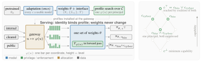

# Capability-Gated Language Models: Security Composes, Utility Does Not

<h3 align="center">NeurIPS 2026 Workshop on Foundations of Language Model Security</h3>

<p align="center">
  <a href="https://github.com/patrikasvanagas">Patrikas Vanagas</a> |
  <a href="https://github.com/augustasio">Augustas Mačijauskas</a> |
  <a href="https://github.com/laurislopata">Laurynas Lopata</a>
</p>


<div align="center">
  <strong>Abstract</strong>
  <p align="left">
    Deployed language model safeguards (safety fine-tuning, filtering,
    unlearning) vary by principal only <em>outside</em> the model weights:
    filters are reconfigured, tiers are multiplied, and artefacts are
    reissued; inside one set of weights every request meets the same
    model configuration. This motivates us to define
    <em>capability-gated deployment</em>: per-principal access control
    inside one set of weights, whose configurations form a lattice — meets
    accumulate a principal's restrictions and joins pool a coalition's
    reach. We instantiate it by sparse rank gating over an existing
    nested-factorisation mechanism, guide profile search with one-pass
    attribution, and read every result once from a pre-registered held-out
    split. Security approximately composes: provably exactly at meets under
    a monotone-elicitation assumption we falsify pointwise. In two lineages
    the median held-out meet deepens suppression; the one effect surviving
    correction strengthens it. Utility does not: individually harmless
    profiles can compose to retention and fluency damage, and no
    compositional bound exists.
  </p>
</div>

## Method

<div align="center">
  
</div>

**Capability-gated deployment.** (a) Adaptation is paid once and yields a single set of weights.
A search over configurations then yields one profile per principal. The gateway binds each
profile to an identity, and the enforcer applies it inside the forward pass. (b) Profiles are
points of a lattice. Composing two profiles descends to their meet (one principal, both
restrictions). Pooling two principals' outputs ascends to their join (a coalition's reach).
Utility constraints bind at meets, and security constraints bind at joins.

## Install

```bash
uv sync                 # Python 3.12; CUDA 12.4 torch wheels on Linux
uv sync --group dev     # + Jupyter kernel for the localisation notebook
```

The optional groups are `eval` (lm-eval) and `logging` (wandb). With pip, use
`pip install -r requirements.txt`.

## Minimal example

```python
from capability_gated import (
    finetune, load_lowrank_checkpoint,
    set_rank_all, set_rank_for_block, set_rank_for_named_module_at_block,
)

# Adapt a small model so that every rank on the ladder stays usable.
trainer, model, tokenizer = finetune(
    base_model_id="EleutherAI/pythia-160m", max_rank=512,
    output_dir="runs/pythia-160m-gated",
    dataset_or_name="wikitext", dataset_config="wikitext-2-raw-v1",
    max_steps=300, batch_size=8,
)

set_rank_all(model, 128)                         # every coordinate at level 128
set_rank_all(model, model.max_rank)              # back to full privilege
set_rank_for_block(model, block_idx=5, rank=64)  # one block
set_rank_for_named_module_at_block(              # one coordinate ("down_proj" on Llama/Qwen)
    model, block_idx=5, module_name="dense_4h_to_h", rank=32)

model, tokenizer = load_lowrank_checkpoint(
    "EleutherAI/pythia-160m", "runs/pythia-160m-gated/final_model", max_rank=512)
```

## Reproducing the paper

Every script documents its options in `--help`.

| Stage | Code |
|---|---|
| Adaptation (mixed-rank recipe) | `scripts/finetune_and_gate.py` |
| Localisation: headroom, attribution, shortlists | `notebooks/mechanistic_interpretability.ipynb` |
| Profile search (split A) | `scripts/find_suppression_configs.py` |
| Measured sublattice (meets and joins) | `scripts/evaluate_lattice_composition.py`, `scripts/lattice_family_bh.py` |
| Gates or filters (probes) | `scripts/probe_gate_or_filter.py`, `scripts/probe_masking_gap.py`, `scripts/probe_depth_sweep.py`, `scripts/probe_capacity_check.py` |
| Off-diagonal usability | `scripts/offdiagonal_sweep.py` |
| WMDP / MMLU evaluation | `scripts/eval_mcq.py` |

The first three stages on Qwen3-1.7B:

```bash
# 1. Adapt with the mixed recipe.
uv run python scripts/finetune_and_gate.py \
    --base-id Qwen/Qwen3-1.7B-Base --max-rank 2048 \
    --train-ranks 2048 1536 1024 768 512 384 256 128 64 32 \
    --dataset HuggingFaceFW/fineweb-edu --dataset-config sample-10BT \
    --max-train-docs 550000 --holdout-docs 2000 \
    --max-steps 48828 --batch-size 16 --grad-accum 2 --block-size 256 \
    --sampling-strategy rank_weighted --variant-mode hybrid --mixed-probability 0.5 \
    --mixed-coordinate-counts 1 2 3 --mixed-coordinate-weights 0.7 0.2 0.1 \
    --svd-baseline --save-steps 12207 --run-name qwen3-1.7b-mixed

# 2. Localise. Writes mech_interp_results/e2_localisation/<checkpoint>/<stamp>/.
E2_CKPT_RUN="$PWD/runs/qwen3-1.7b-mixed" uv run --with nbconvert --with ipykernel \
    jupyter nbconvert --to notebook --execute --ExecutePreprocessor.timeout=-1 \
    --output-dir runs notebooks/mechanistic_interpretability.ipynb

# 3. Search profiles. Drop --estimate-only to run the search.
uv run python scripts/find_suppression_configs.py \
    --e2-run mech_interp_results/e2_localisation/<checkpoint>/<stamp> --estimate-only
```

The frozen A/B split indices are in `mech_interp_results/splits_v1.json`. Split B can only be
read with an explicit unlock reason. The repository does not include adapted checkpoints, raw
outputs or figure files.

## Tests

```bash
uv run --with pytest python -m pytest tests/   # some tests download models from the HF Hub
```

## Citation

```bibtex
@misc{vanagas2026capabilitygatedlanguagemodelssecurity,
      title={Capability-Gated Language Models: Security Composes, Utility Does Not}, 
      author={Patrikas Vanagas and Augustas Mačijauskas and Laurynas Lopata},
      year={2026},
      eprint={2609.00445},
      archivePrefix={arXiv},
      primaryClass={cs.CR},
      url={https://arxiv.org/abs/2609.00445}, 
}
```

## License

MIT, see [LICENSE](LICENSE).
